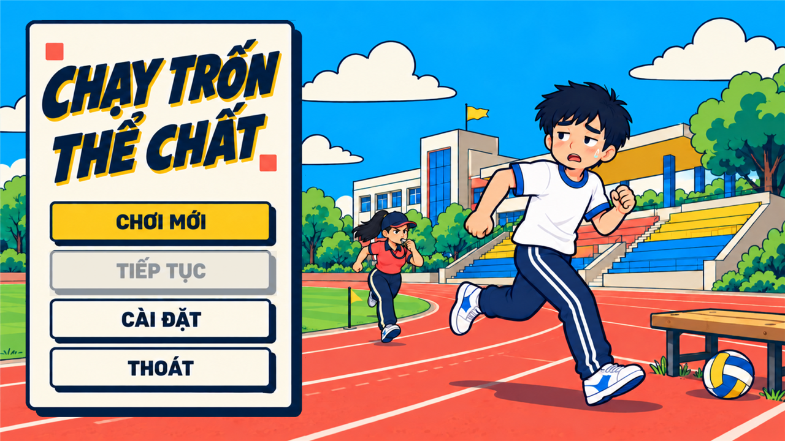
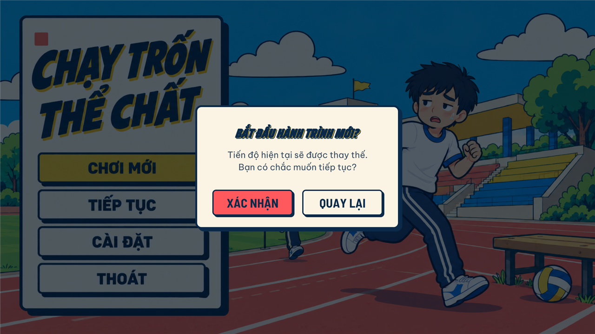
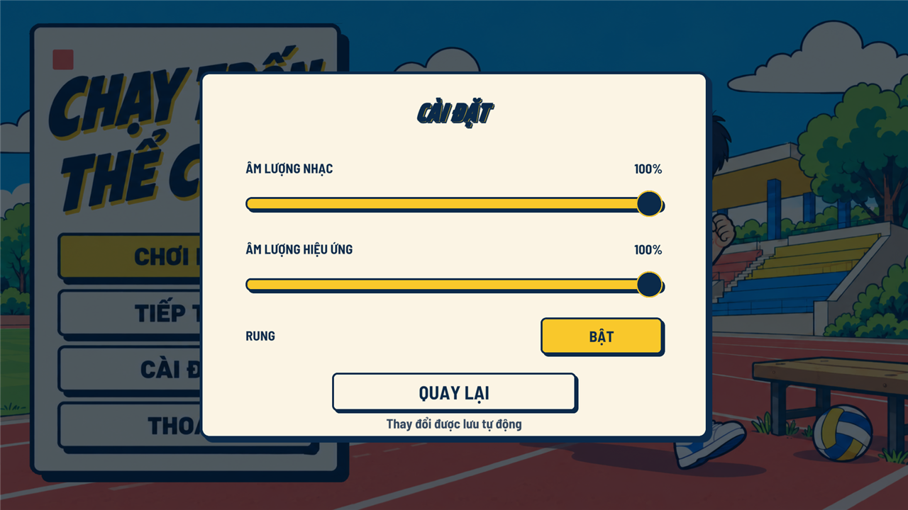
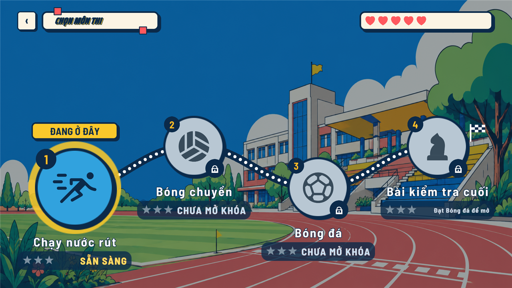
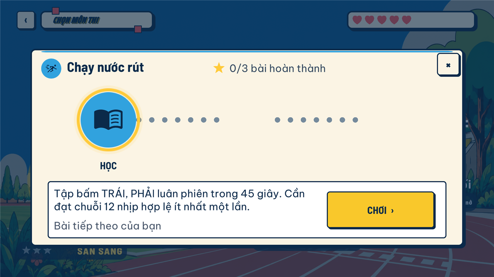
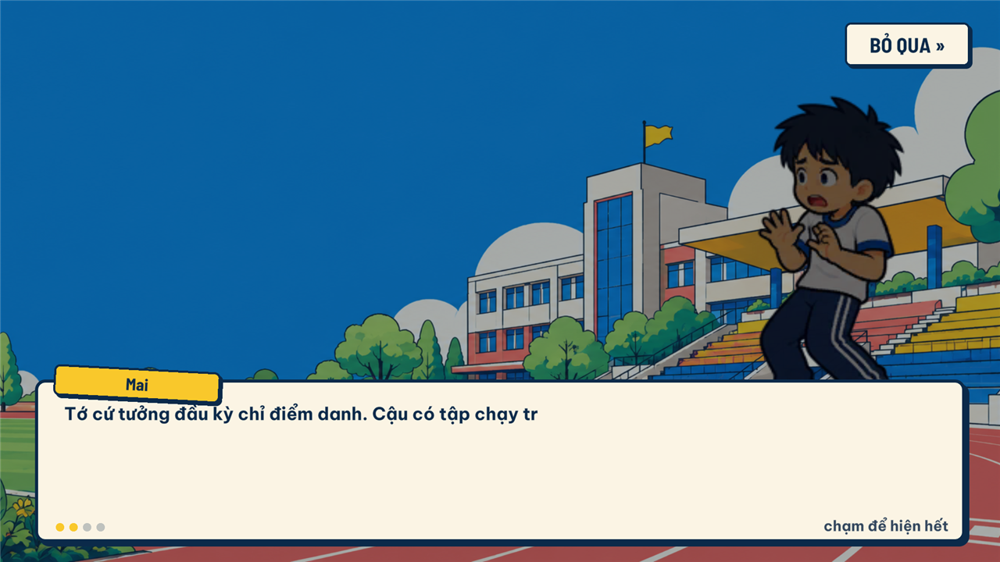
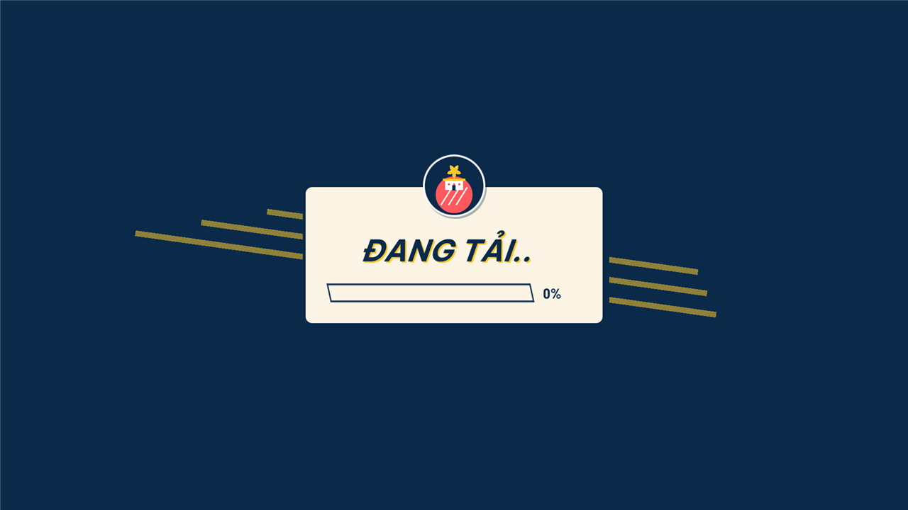
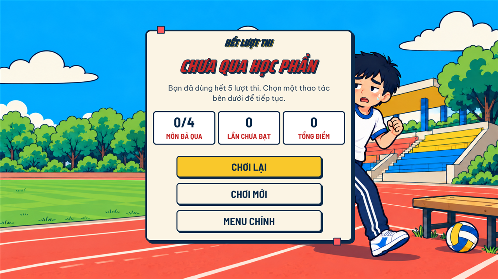
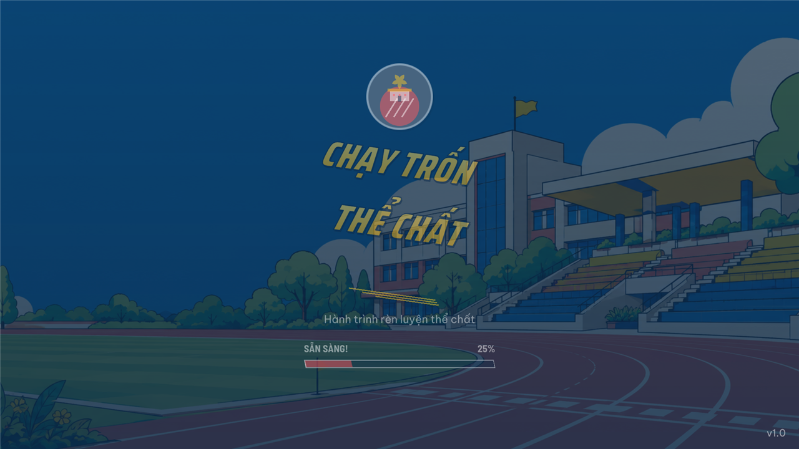
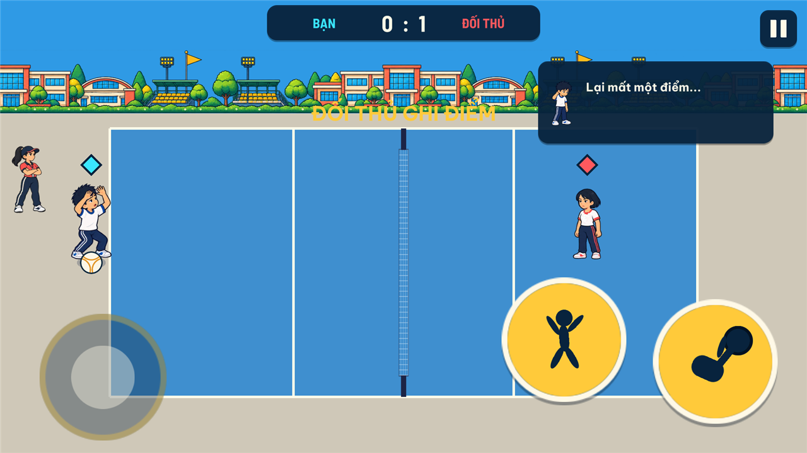

# Shell UI style pass - QA (2026-10-13)

Spec: `docs/superpowers/specs/2026-10-13-shell-ui-style-design.md` (the "before" state is the audit in section 2 of the spec).

## What changed per screen

- Menu: title card, buttons (Play yellow, Continue, Settings, Quit) and the new-game confirm card drawn with ShellKit tokens; disabled Continue is greyed.
- Settings: cream card with yellow sliders, Shell toggle button and BACK button.
- Map: header chip, hearts bar, round stop badges with lock glyphs, "DANG O DAY" stop tag, star/status plates on Shell tokens.
- Map lesson popup: Shell card with coloured top rail, round close button with a "x" glyph, yellow PLAY button.
- Journey dialogue: cream dialogue box, yellow speaker tag, progress dots, Skip button.
- Scene transition: navy panel with cream card, speed lines, parallelogram loading bar and percent label.
- GameOver: cream result card with stat tiles and Shell buttons (the in-game dialogue bubble stays Kit, dark navy, by design).
- Bootstrap splash: Shell title lettering, status and percent labels at 24 px or more.
- MG_Volleyball: round kit buttons (hit / jump) and score HUD; every minigame HUD audited by the Shell guard tests.

## Tests (final run, Editor closed, `KMA.Tests`)

| Suite | Total | Passed | Failed |
|---|---|---|---|
| EditMode | 1108 | 1107 | 1 (known) |
| PlayMode | 401 | 400 | 1 (known) |

Result files: `Builds/TestResults/editmode-final.xml`, `Builds/TestResults/playmode-final.xml` (not committed). The only failures are the two known stale tests below.

## Captures (Unity Editor, Play Mode)

Full-size captures are in `Builds/Screenshots/shell/` (not committed); docs copies are 1280x720 downscales of the 16:9 captures.

| Screen | 16:9 (1920x1080) | 20:9 (2400x1080) |
|---|---|---|
| Menu |  | Builds/Screenshots/shell/menu-209.png |
| Menu, new-game confirm |  | Builds/Screenshots/shell/menu-confirm-209.png |
| Settings |  | Builds/Screenshots/shell/settings-209.png |
| Map |  | Builds/Screenshots/shell/map-209.png |
| Map, lesson popup |  | Builds/Screenshots/shell/map-lessons-209.png |
| Map, journey dialogue |  | Builds/Screenshots/shell/map-dialogue-209.png |
| Scene transition |  | Builds/Screenshots/shell/transition-209.png |
| GameOver |  | Builds/Screenshots/shell/gameover-209.png |
| Bootstrap splash |  | Builds/Screenshots/shell/bootstrap-209.png |
| MG_Volleyball |  | Builds/Screenshots/shell/volleyball-209.png |

Checks: close glyph renders as a bold x (not a box); disabled Continue reads as locked (grey); no layer misalignment at 20:9; no text overflowing its box in the captured states.

## Known issues

- `FrogJumpRulesTests.FasterDefaultSweepsEachEdgeInPointSevenSeconds` (EditMode) and `FrogJumpDialogueTests.FinishOnFinalLandingDoesNotQueueGoodJump` (PlayMode) fail: stale since c111cf1 changed sweepSeconds from 0.7 to 1. Unrelated to this pass.
- Map (fixed in 8e29038, re-captured 2026-10-13): the "DANG O DAY" tag now sits just above the yellow glow ring around stop 1 with a small visible gap (about 7 px at 1920x1080) instead of touching it; the stop label and star/status plate stay on screen (bottom plate ends about 70 px above the bottom edge). The lesson popup close button is fully inside the panel. Map captures above are the refreshed ones.
- Bootstrap capture lands mid fade-in (dimmed, 25%).
- Volleyball "DOI THU GHI DIEM" banner (yellow on light court) has low contrast; pre-existing, outside this pass.
- Journey dialogue speaker tag sits close to the first text line; legible, left as is.
- Capture states were reached with temporary, uncommitted QA states for the Menu confirm card and the transition overlay.
