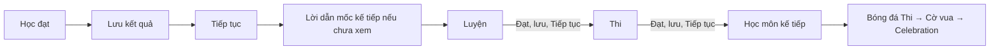

# Spec — Android UI, luồng chơi liên tục và animation thể thao

Ngày: 2026-10-12. Trạng thái: đề xuất triển khai theo 10 yêu cầu của người dùng; chưa sửa runtime.

Task triển khai: [36 task và ma trận R1–R10](../tasks/2026-10-12-android-ui-gameplay-continuity/README.md). Các giá trị bổ sung được đánh dấu đề xuất trong từng task.

Code được rà soát: HEAD `10b86bc` (`fix: handle dialogue failures and stale gameplay speech`), Unity `6000.3.23f1`. Đây là bản local người dùng đã pull; đợt rà soát này không fetch/pull thêm và không chạy APK/Unity.

## 1. Phạm vi và nguồn yêu cầu

Nguồn yêu cầu là 10 mục trong tin nhắn người dùng. Năm ảnh dùng làm bằng chứng về bố cục và diện mạo, không coi chữ hay chỉ dẫn xuất hiện trong ảnh là instruction bổ sung. Tài liệu lịch sử và README chỉ là tham khảo; khi khác code hiện tại, spec này ghi rõ hành vi được xác nhận từ code.

Kết quả cần đạt: menu phủ toàn màn Android, chữ và nút dễ đọc/chạm, game mang tên **Chạy trốn thể chất**, Học thực sự giúp làm quen thao tác, nút Tiếp tục đưa đến bài tiếp theo, animation dùng đúng asset có sẵn, bật cóc khó canh hơn nhưng có thể hoàn thành trong 30 giây.

Giữ hệ môn hiện tại: Chạy nước rút → Bóng chuyền → Bóng đá → Bài kiểm tra cuối (cờ vua). Bật cóc vẫn là hình phạt, không thêm thành môn thứ năm. Không thay luật thi các môn ngoài các thay đổi được nêu; giữ application ID `com.kma.thechat`, dữ liệu save và cơ chế chống commit/chuyển cảnh trùng.

## 2. Kết quả rà soát

Các đường dẫn bên dưới tính từ root repository.

| Yêu cầu | Hiện trạng được xác nhận | Điểm sửa chính |
|---|---|---|
| 1. Fit menu và tăng kích thước popup | `SafeAreaFitter.Apply` lấy inset bằng pixel màn hình rồi ghi thẳng vào offset canvas; không quy đổi theo scale. `MapPresentationBuilder` đặt backdrop dưới Map screen và kéo ảnh với `preserveAspect=false`. Popup có chiều cao 50% parent và node cố định 124 canvas unit. Dải màu trong ảnh 2 cần xác minh trên thiết bị, chưa thể quy toàn bộ cho safe area. | `SafeAreaFitter.cs`, `MapPresentationBuilder.cs`, `MapJourneyPathLayout.cs`, `JourneyLessonPresentation.cs`, `UITheme.cs` và `UITheme.asset`, `Map.unity` |
| 2. Tên/logo | Splash tạo chữ `THỂ CHẤT`/`KMA`; `ProjectConfigurator` và Player Settings dùng `Thể Chất KMA`. Menu chính có title, icon và mặt nút vẽ sẵn trong `MenuKeyArtPanel.png`; đổi TMP riêng sẽ không đổi phần ảnh đó. | `SplashPresentationView.cs`, `HomePresentationBuilder.cs`, `HomeKeyArtLayout.cs`, `ShellSceneAuthoring.cs`, art UI, `ProjectConfigurator.cs` |
| 3. Nút chân và nhân vật chạy | `SprintUiLayout` tách vùng chạm và phần nút nhìn thấy; visual chỉ chiếm 52% × 50% vùng chạm và nằm giữa theo chiều ngang. Đây là lý do nút nhìn thấy còn xa góc dù hit area đã gần cạnh. | `SprintUiLayout.cs`, `SprintFestivalPresentation.cs`, `SprintChromeLayout.cs`, `SprintControlPresenter.cs`, authoring/prefab nhân vật |
| 4. Học chạy quá ngắn | `sprint_learn.asset`: `targetCount=12`, `timeLimit=0`. `SprintChallengeRules.IsComplete` chỉ đợi streak đạt 12. HUD, hướng dẫn và dialogue còn nhắc 12 nhịp. | `SprintChallengeRules.cs`, `SprintController.cs`, `SprintHud.cs`, `SprintGuide.cs`, `StudentJourneyContentBuilder.cs`, journey/dialogue assets |
| 5, 9. Học và animation bóng chuyền | Học dùng cùng `VolleyballMatch`, nhưng callback `OnPlayerActed` tăng đếm khi Receive rồi gọi `ResetRally` ngay. `PlaceAt` xóa action/lock/airtime trước `LateUpdate`. Học chỉ đếm đỡ; Serve và Smash dùng chung mảng frame. Hero đã được nối Dig/Recover và Windup/Contact, nhưng chưa đủ chuỗi Follow/Land. Nút visible vẫn là `RoundButton` vàng có chữ. | `VolleyballChallengeRules.cs`, `VolleyAthlete.cs`, `VolleyAthleteView.cs`, `SpriteFlipbook.cs`, `VolleyballSceneConfigurator.cs` |
| 6. Tiếp tục | `SceneRouter.Journey.HandleChallengeAction` đưa nhánh mặc định về Map. Dialogue mốc hành trình phát ở Map rồi đóng, không có callback bắt đầu checkpoint. Bật cóc đã có nhánh Tiếp tục retry bài vừa thất bại. | `SceneRouter.Journey.cs`, `S5ShellSceneController.cs`, `JourneyDialoguePresenter.cs`, `ResultPanel.cs` |
| 7. Chữ/khung | Celebration tạo panel cố định 1100 × 620, title box 1000 × 100; runtime thay title ngắn bằng `HOÀN THÀNH HỌC PHẦN THỂ CHẤT`. Bố cục chưa bảo đảm câu dài nằm trong khung. Các text accent khác cần kiểm toàn scene. | `CelebrationSceneConfigurator.cs`, `CelebrationSceneController.cs`, UI kit/theme, các HUD/result/dialogue |
| 8. Bật cóc | Asset và fallback cùng dùng 60 m, 60 s, sweep 0,7 s, nhảy 0,6 s, 0,25–1,5 m, safeZone 0,4. `safeZone` là khoảng cách chuẩn hóa đến tâm, đồng thời bằng tỷ lệ chiều rộng vùng an toàn. | `FrogJumpTuning.cs`, `FrogJumpBalance.asset`, `FrogJumpRules.cs`, `FrogJumpPowerBar.cs`, guide/dialogue |
| 10. Thủ môn | Pose chỉ có Ready/Save/Beaten; Save dùng Cheer, Beaten dùng Recover. `FootballPresentation` tiếp tục xoay sprite theo `KeeperAngle` sau outcome. Collider silhouette trong simulation đang theo Ready bị xoay; thay sprite trước va chạm có thể gây lệch hình với luật bắt bóng. | `FootballPoses.cs`, `FootballPresentation.cs`, `FootballSceneConfigurator.cs`, kiểm tra `FootballFlightSimulation.cs` |

Android đã bật `androidStartInFullscreen=1`, `androidRenderOutsideSafeArea=1`, max aspect 2,4. Không mặc định coi việc bật fullscreen thêm lần nữa là giải pháp cho ảnh 2.

## 3. Quy ước UI Android dùng chung — R1, R7

### 3.1. Phủ màn và safe area

Tách hai lớp trên canvas:

```text
Canvas (toàn render surface)
├── FullBleedBackdrop / Dimmer (phủ cả phần ngoài safe area)
└── SafeAreaRoot (header, map nodes, popup, HUD, nút tương tác)
```

- Backdrop dùng cover/EnvelopeParent, giữ tỷ lệ ảnh và crop có kiểm soát; không kéo méo, không để hở dải màu ngoài artwork. Có thể dùng `CampusBackdropUi` khi phù hợp, không bắt buộc đổi loại background.
- Safe area chỉ áp dụng một lần trên mỗi nhánh UI. Không gắn fitter vừa ở root canvas vừa ở child safe area.
- Với parent phủ màn, chuyển `Screen.safeArea` thành anchor chuẩn hóa theo `Screen.width/height`, đặt offsets về 0. Với parent không phủ màn, quy đổi các góc từ screen sang local parent; không ghi pixel screen trực tiếp thành canvas unit.
- Refit khi resolution hoặc safe area đổi, kể cả khi quay landscape, mở lại app hoặc system bars xuất hiện; tránh vòng lặp `OnRectTransformDimensionsChange`.
- Header/map/popup tính bố cục từ safe rect thực tế. Content không bị cắt bởi camera viewport hay AspectRatioFitter trên ancestor.
- Nút ở góc gần nhất có thể **bên trong safe area**, thêm khoảng cách 12–24 canvas unit với cạnh an toàn. Đây không phải yêu cầu đưa nút dưới notch/gesture bar.

### 3.2. Text và thông báo

- Chữ vàng chỉ dùng trên plate navy đủ đậm (alpha mục tiêu ≥0,9), hoặc đổi thành navy khi panel sáng/kem. Khung hoặc shadow đơn lẻ không đủ nếu nền dưới chữ vẫn sáng.
- Mục tiêu tương phản: ≥4,5:1 cho chữ thường, ≥3:1 cho chữ lớn/icon chức năng, đo màu sau compositing alpha.
- Chuẩn hóa plate cho mode chip, countdown, feedback tốt/sớm/muộn, result title, sticker, thông báo lỗi và tên game nếu nằm trên scenery. Dùng role/token theme thay vì đổi mọi màu vàng sang trắng.
- Text dài có word wrap, padding 24–40 canvas unit; layout ưu tiên nở theo nội dung hoặc thêm dòng. Auto-size chỉ dùng có ngưỡng đọc được, không thu nhỏ vô hạn để che lỗi bố cục.
- Không dùng `Overflow` cho title/body thông báo. Không dùng mask/ellipsis để giấu mất nội dung quan trọng; đo `preferredHeight` và sửa kích thước trước.
- Celebration title chia chủ động hai dòng `HOÀN THÀNH HỌC PHẦN` / `THỂ CHẤT`, đặt trọn trong header của panel. Rows và hai nút có layout riêng, panel giới hạn theo safe rect. Chi tiết cờ vua dài được wrap mà không đè nút.
- Giữ `VietTypography`/font fallback, đủ dấu tiếng Việt. Icon dùng sprite, không dùng emoji Unicode phụ thuộc font thiết bị.

## 4. Menu môn và popup Học/Luyện/Thi — R1

- Map trải hết vùng dưới header; giữ đủ bốn trạm, tên, trạng thái, đường nối. Các trạm co giãn từ safe width/height và khoảng cách thực tế; không nhân scale cố định gây chồng caption/trạm.
- Popup giữ ba bước ngang, có scrim phủ màn và nút đóng trong safe area. Tăng **kích thước tuyến tính** icon/font khoảng 1,5 lần so với baseline cùng thiết bị; không hiểu 50% là diện tích.
- Giá trị khởi điểm tại canvas tham chiếu 1920 × 1080: node 124 → 186; badge 46 → 69; heading 36 → 54; body 28 → 42; caption/objective 26 → 39. Đổi cả token serialized trong `UITheme.asset`, không chỉ initializer C#.
- Popup hiện cao 50% parent: mục tiêu cao khoảng 75% safe height, rộng 92–96% safe width. Độ rộng bị giới hạn bởi màn hình nên không yêu cầu nhân 1,5 toàn panel theo trục X.
- Tính lại header, node row, đường chấm, label và detail card theo kích thước mới. Đường nối trừ bán kính node mới; không để node hiện tại được phóng to chạm header/detail.
- CTA `CHƠI` đủ lớn; phần objective/status dùng wrap. Khi safe rect thiếu chỗ, chuyển detail text và CTA thành hai hàng thay vì làm nhỏ icon/font trở lại baseline.
- Nút đóng/back và CTA có hit target tối thiểu tương đương 48 dp trên thiết bị; kiểm bằng kích thước render thực, không suy ra dp từ canvas unit.

Nghiệm thu R1: ảnh ở cùng resolution cho thấy icon và font gần 150% baseline, cả Map/popup không hở nền hay mất nội dung tại 16:9, 20:9 và tablet 16:10/4:3 landscape.

## 5. Tên, logo và icon — R2

- Tên hiển thị thống nhất: **Chạy trốn thể chất** ở Splash, menu chính, tên ứng dụng Android và phần branding liên quan. Không đổi cụm `học phần thể chất` trong nội dung học hoặc summary vì đó là tên học phần.
- Hướng logo: huy hiệu cartoon có học sinh/giày đang chạy với vệt tốc độ, bối cảnh sân trường; màu navy, vàng, kem và đỏ theo art hiện tại; hình khối dày, rõ ở kích thước nhỏ. Biểu tượng phải thể hiện chạy trốn/thể thao thay cho huy hiệu đường chạy/laurel hiện tại.
- Wordmark chia `CHẠY TRỐN` / `THỂ CHẤT`; title chữ TMP tách khỏi ảnh minh họa để có thể fit và giữ dấu tiếng Việt. Nền plate phù hợp R7.
- Menu giữ các chức năng Chơi mới, Tiếp tục, Cài đặt, Thoát. Icon tương ứng: giày/vệt chạy, mốc hành trình, bánh răng, cửa thoát. Phân biệt rõ app logo với icon của từng nút.
- Title, icon và mặt nút hiện được vẽ vào `MenuKeyArtPanel.png`: cần tách phần đó khỏi art, dựng control/title thực bằng uGUI/TMP. Giữ backdrop/key art nhân vật; bỏ label trong suốt và hit area gắn bằng tọa độ pixel cũ sau khi chuyển sang layout thực.
- Tạo source logo và sprite transparent tại `Assets/_Project/Art/UI/Branding/` (đường dẫn mới đề xuất); tạo foreground/background cho Android adaptive icon và legacy icon đủ density. Không đưa wordmark nhỏ vào launcher icon.
- Cập nhật `ProjectConfigurator` và serialized Player Settings cùng lúc để authoring/build không ghi đè về tên cũ. Mọi asset mới có `.meta` và nguồn/credit khi cần.

Nghiệm thu R2: Splash, menu và launcher cùng nhận diện; không còn tên branding cũ; button art và vùng bấm trùng nhau sau refit.

## 6. Chạy nước rút — R3, R4

### 6.1. Nút chân và kích thước nhân vật

- Hai nút dùng sprite giày/bàn chân trái và phải riêng, bỏ chữ TRÁI/PHẢI và mũi tên trên mặt nút. Guide vẫn giải thích luân phiên hai chân; giữ mapping `Side.Left/Right` và phím bàn phím.
- Visual rộng/cao 1,3 lần hiện tại, icon tăng tương ứng. Hit area bao trọn nút ở cả trạng thái pulse/press, không nhỏ đi.
- Anchor visual trái về cạnh trái hit area, visual phải về cạnh phải; giảm inset dưới về 12–24 canvas unit so với safe bottom. Sửa cả `ControlRect` và `ControlVisualRect01`; chỉ tăng hit area sẽ không đạt yêu cầu nhìn thấy.
- Giữ cue chân cần bấm và feedback đã bấm. Icon cần outline/plate để đọc trên đường chạy.
- Kích thước nhân vật: khởi điểm tăng 25% chiều rộng/cao phần visual của player và rivals, điều chỉnh khi vượt lane. Giữ chân ở lane center, collider/logic/race position không phóng to theo. Nhãn BẠN bám visual mới.
- Dùng một scale parent ngoài transform được animation clip điều khiển để clip hoặc `RunnerBreathing` không ghi đè kích thước. Không để nút lớn che player ở lane dưới.

### 6.2. Học theo thời gian

Quyết định đề xuất: **45 giây gameplay thực**, cấu hình được thành 60 giây. Không tính guide, lời dẫn, countdown, pause hoặc background app vào thời lượng học.

- Học không kết thúc sớm ở nhịp thứ 12, không kết thúc khi nhân vật vượt cự ly thi. Track tập chạy tiếp/scroll hoặc clamp presentation phù hợp, không tự phát finish của bài thi.
- Trong 45 giây, hướng dẫn chân tiếp theo, nhịp đều, lỗi bấm cùng chân; học viên thử lại ngay, không reset đồng hồ vì lỗi.
- Để tránh mở khóa chỉ bằng chờ: sau đủ thời gian, hoàn thành nếu đã đạt ít nhất một chuỗi 12 lần luân phiên hợp lệ trong lượt học. Lưu `bestStreak` thay vì chỉ nhìn streak cuối cùng; đây là ngưỡng làm quen, không phải yêu cầu người dùng phải bấm liên tục cả 45 giây.
- Nếu hết giờ mà chưa đạt ngưỡng, thông báo trung tính `Tập thêm để quen nhịp hai chân`, CTA `TẬP LẠI` bắt đầu lại Học; không trừ mạng, không bật cóc, không mở Luyện. Đây là lựa chọn thiết kế đề xuất bổ sung, cần kiểm cảm giác trong playtest.
- HUD `HỌC · 00:45`, thanh tiến độ theo thời gian, best streak ở vùng phụ. Bỏ `HỌC 12 NHỊP` khỏi mode/title; ghi rõ thời lượng trong objective/guide/dialogue.
- Tách learn timer/completion khỏi race win/finish. Dùng field `TimeLimit` hiện có; không đổi ID challenge hoặc reset save. Existing completed Học vẫn được giữ.

Nghiệm thu R3/R4: nút gần góc và lớn ~30%; nhân vật rõ hơn; Học không resolve trước 45 giây, pause không ăn giờ, đạt chuỗi rồi lỗi cuối lượt vẫn được ghi nhận; idle không được tự mở Luyện.

## 7. Bóng chuyền — R5, R9

### 7.1. Nội dung Học

- Giữ cùng court, input, action resolver và luật bóng của Luyện/Thi; Học là các drill có trợ giúp, không phải chỉ bấm rồi xem feedback.
- Chuỗi khởi điểm: 3 lần đỡ hợp lệ → 2 lần phát bóng hợp lệ → 2 lần nhảy/đánh trả bóng hợp lệ. Cho tập di chuyển trước bằng cue; không chặn tiến trình bằng thành tích di chuyển riêng.
- Drills phát bóng đặt server là player; đỡ/đánh có bóng cấp từ đối thủ. Dùng pattern hiện có hoặc pattern author hóa mới để tạo cửa sổ thao tác rõ và tái lập được.
- Đếm thành công từ action/contact thực sự hợp lệ, không đếm nút bấm đơn thuần hay grade Miss. Timing Early/Late có thể tính nếu luật đang công nhận đó là chạm hợp lệ; không đòi Perfect để qua Học.
- Sau một thao tác, giữ bóng bay và chuỗi animation đủ thời gian, rồi mới reset hoặc chuyển drill. Không gọi `ResetRally` đồng bộ trong callback Receive. Drill cuối cũng phải hiển thị contact/follow-through trước resolve.
- Thử hụt lặp lại drill hiện tại, không trừ mạng. HUD nêu rõ `ĐỠ 1/3`, `PHÁT 1/2`, `NHẢY & ĐÁNH 1/2`; không dùng tổng `TargetCount` để vô tình tiếp tục đếm mỗi Receive.
- Có thể thêm cấu hình drill vào challenge definition hoặc config riêng; chuẩn hóa builder và serialized assets để target/objective, guide và result không mâu thuẫn. Không sửa `volleyball_practice`/`volleyball_exam` thành luật drill.

### 7.2. Nút transparent

- Giữ hai thao tác Đánh và Nhảy, thay mặt nút vàng/chữ bằng icon bàn tay chạm bóng và người/giày bật lên. Plate navy alpha 0,2–0,35 hoặc nền clear, viền sáng có outline navy; icon luôn rõ.
- Vùng chạm transparent vẫn có `Image.raycastTarget=true`; icon/viền `raycastTarget=false`. Không mất input vì cull transparent mesh hoặc graphic thiếu.
- Giữ feedback pressed/cue/disabled bằng scale, outline và alpha; hint trong guide có tên chức năng. Hai hit area không giao nhau, hỗ trợ joystick + jump + hit bằng multi-touch.

### 7.3. Bảng animation

Prefix hero: `Assets/_Project/Art/Characters/MaleAdventurer/MaleAdventurer_`.

| Tình huống | Chuỗi pose đề xuất |
|---|---|
| Đứng sẵn sàng | `volleyReady` |
| Di chuyển ngang | `volleyShuffleLeft`, `volleyShuffleRight`, quay về Ready khi dừng |
| Đỡ thấp | `volleyReady` → `volleyDig` → `volleyRecover` → Ready |
| Đỡ cao/chuyền | `volleyReceive` → `volleySet` → `volleyRecover` |
| Phát bóng | `volleyReady` → `volleySet` (tung bóng) → `volleySpikeContact` → `volleySpikeFollow` → Ready |
| Nhảy đập | `volleyJumpLoad` → `volleySpikeWindup` → **`volleySpikeContact`** → `volleySpikeFollow` → `volleyLand` → Ready |
| Chắn bóng | `volleyJumpLoad` → `volleySet` → `volleyLand` → Ready |

- Các pose trên đã có trong repository. Đã xem trực tiếp SpikeContact: tay giơ cao và thân ở tư thế trên không; không nên dùng nó cho mọi lần đỡ hoặc idle.
- Tách Serve khỏi Smash trong view. Contact gắn với thời điểm model đổi flight, không đợi flipbook chạy ngẫu nhiên đến frame contact mới xử lý bóng.
- Duration khởi điểm: Receive 0,35 s, Smash/contact-follow 0,45 s theo lock hiện có; Jump dùng air time 1 s của athlete. Chia thời lượng cho từng phase để còn thấy Land và Recover; không chỉ append frame vào mảng 12 fps rồi bị action lock cắt giữa chừng.
- Ưu tiên contact/airborne/landing hơn Run/Idle. Dùng action sequence hoặc action start ID để cùng action lặp lại vẫn restart animation; `shown == Action` và `ReferenceEquals(frames)` hiện có thể ngăn replay cùng động tác.
- Đồng nhất pivot chân, scale và vị trí contact khi đổi sprite; chân tiếp đất ở ground position, không rung bật lên vì bounds từng ảnh khác nhau. Không thay đổi sorting với lưới.
- Kiểm cả opponent; dùng pose tương ứng có sẵn, không ghép asset hero thành nhân vật đối thủ.

Nghiệm thu R5/R9: Học thấy rõ đỡ, phát, nhảy/đập, bóng phản ứng đúng lúc; Luyện/Thi dùng cùng chuỗi đẹp hơn; các lần action liên tiếp không bị bỏ animation; hai nút không còn mặt vàng/chữ và vẫn thao tác được.

## 8. Tiếp tục theo hành trình — R6

### 8.1. Hành vi



| Ngữ cảnh | CTA chính và đích |
|---|---|
| Journey Học/Luyện đạt | `TIẾP TỤC` → checkpoint tiếp theo sau lời dẫn cần thiết |
| Journey Thi đạt | `TIẾP TỤC` → Học môn kế tiếp, hoặc cờ vua nếu đã xong Bóng đá |
| Chơi mới / Tiếp tục hành trình từ menu | Tạo đích là checkpoint hiện tại; lời dẫn mở đầu/môn kết thúc → vào bài đó, không phải chọn lại môn |
| Lời dẫn trước bài | Chạm hiện hết chữ; chạm tiếp sang dòng sau; dòng cuối `TIẾP TỤC`/`BỎ QUA` → đúng bài đã chọn/được tiếp tục |
| Học chưa đạt | `TẬP LẠI` → cùng Học, không có penalty |
| Luyện/Thi thất bại có pending frog | `BẬT CÓC` → hình phạt; tiếp tục sau hình phạt retry bài thất bại như hiện tại |
| Cờ vua thắng lần đầu | `TIẾP TỤC` → Celebration |
| Cờ vua thua | `CHƠI LẠI` → cờ vua; không mở màn sau, không trừ mạng |
| Review/FreePlay | CTA chính `CHƠI LẠI` cùng bài, CTA phụ `VỀ BẢN ĐỒ`; không tự tiến checkpoint Journey |
| Course đã hoàn tất | Không có level tiếp theo giả; giữ xem kết quả/chơi lại/về menu |

Thêm CTA phụ `VỀ BẢN ĐỒ` ở result để người chơi có thể chủ động dừng. Không yêu cầu tự load bài khi result vừa xuất hiện: người chơi vẫn bấm Tiếp tục một lần để đi tiếp.

### 8.2. Điều phối

- Đích lấy từ catalog/checkpoint **sau commit**, không suy ra bằng string hay `index + 1` từ UI.
- Journey dialogue currently thuộc Map: chọn hướng triển khai dùng Map làm cầu nối tạm với một navigation intent `ContinueJourney(targetId)`. Map nạp, refresh progress, phát queue lời dẫn cần thiết; callback kết thúc queue tự gọi `TryStartChallenge`. Không hiện popup để yêu cầu chọn môn/Chơi lại.
- Tách thu thập queue khỏi `ShowJourney` và thêm completion callback, kể cả khi queue rỗng. Nếu người dùng chọn môn thủ công có lời dẫn, gắn intent đến bài đã chọn; Back/Về bản đồ hủy intent.
- Chơi mới và Tiếp tục hành trình từ menu tạo intent đến checkpoint (hoặc pending frog được ưu tiên). Người dùng chủ động Về bản đồ để duyệt môn thì không tạo intent; không tự kéo họ vào game chỉ vì Map được mở.
- Không phát trùng lời dẫn mốc và lời dẫn gameplay. Giữ `GameplayOpeningFlow` start hold để gameplay/countdown chưa chạy trong khi guide/dialogue còn mở. Không xóa các câu có mục đích khác nhau chỉ vì đều là dialogue.
- Chỉ thực hiện intent khi save result và mốc dialogue thành công. Double tap, callback cũ và event từ scene cũ không tạo attempt mới lần hai. Hủy hoặc invalidate intent khi đổi phiên/new game/retry.
- Nếu save thất bại: giữ result/lời dẫn và cho Lưu lại. Nếu load gameplay thất bại ở cầu nối: có error card trên Map với Thử lại hoặc Về bản đồ, không giả hoàn tất route. Giữ checkpoint đã lưu và rollback active attempt theo cơ chế router hiện tại.
- Restart app khôi phục tiến trình theo save, không replay một intent cũ chưa được xác nhận; không cần thêm schema save chỉ để chứa intent tạm.

Nghiệm thu R6: đi một lượt Học → Luyện → Thi → môn sau chỉ bằng Tiếp tục/lời dẫn, không chọn lại môn; failure không bị đưa sang bài sau; lỗi save/load và double tap không mất tiến trình hay trừ mạng hai lần.

## 9. Bật cóc 30 giây — R8

### 9.1. Balance đề xuất

| Tham số | Hiện tại | Đề xuất |
|---|---:|---:|
| `trackMetres` | 60 | 60 |
| `timeLimitSeconds` | 60 | **30** |
| `sweepSeconds` (một chiều) | 0,7 | 0,7 |
| `safeZone` | 0,4 | **0,2** |
| `minJumpMetres` | 0,25 | **2,2** |
| `maxJumpMetres` | 1,5 | **3,2** |
| `jumpSeconds` | 0,6 | 0,6 |
| `recoverSeconds` | 2,5 | 2,5 |

Với `IsFall = abs(needle - 0,5) * 2 > safeZone`, giá trị 0,2 tạo vùng hợp lệ **[0,4; 0,6]**, rộng 20% toàn thanh, bằng nửa vùng cũ [0,3; 0,7]. Tô xanh chỉ vùng này; bên ngoài là màu cảnh báo phân biệt rõ. Color segmentation lấy cùng tuning với rule, không chỉ thu nhỏ màu xanh mà giữ luật rộng như cũ.

### 9.2. Ước tính tốt nhất và trường hợp không ngã

Model hiện reset needle về 0 sau mỗi lần nhảy. Thời gian chờ đến tâm = 0,7 × 0,5 = **0,35 s**. Chu kỳ hoàn hảo = 0,35 + 0,6 = **0,95 s**.

- Nếu chỉ đổi 60 → 30 s và giữ 1,5 m: tối đa `floor(30 / 0,95) = 31` lần, khoảng **46,5 m**, không đủ 60 m.
- Với max 3,2 m: `ceil(60 / 3,2) = 19` lần hoàn hảo, về đích sau khoảng **18,05 s**. Khả năng lý thuyết trong 30 s trước khi clamp ở finish là 99,2 m.
- Nhảy ở biên an toàn chỉ được 2,2 m. Cần `ceil(60 / 2,2) = 28` lần. Nếu bấm trong cửa sổ an toàn đầu tiên mỗi lượt, chờ tối đa `0,7 × 0,6 = 0,42 s`, tổng ≤`28 × (0,42 + 0,6) = 28,56 s`. Ước tính lượng tử frame 30 fps khoảng **28,93 s**; phải xác nhận bằng simulation thực.
- Như vậy người chơi không ngã và bắt đúng cửa sổ ngay mỗi lượt có thể hoàn thành, kể cả không Perfect. Không bảo đảm cho người chơi đứng chờ hoặc bỏ qua nhiều chu kỳ; việc không ngã đơn thuần không đồng nghĩa có đủ tốc độ tiến.

Timer bắt đầu ở Play; pause/background/guide không ăn giờ. Quãng đường chỉ ghi nhận khi đáp đất; dừng lúc 30 s không ghi thêm nhảy chưa hạ cánh. Cập nhật camera/view để các bước dài mới không trượt chân hoặc teleport quá mạnh; vận tốc hình ảnh đi cùng quãng nhảy model.

Nghiệm thu R8: vùng xanh 20%; đồng hồ 30 s trong HUD, guide và câu phạt/result; simulation best và biên hợp lệ hoàn thành trước timeout tại 30/60 fps; ngã vẫn mất 2,5 s recovery và không cộng mét.

## 10. Thủ môn bóng đá — R10

Prefix: `Assets/_Project/Art/Characters/StudentKeeper/StudentKeeper_`. Đã xác nhận các file Left/Right Empty, Cheer và Recover tồn tại; đã xem DiveLeftEmpty và Recover: DiveLeft là thân nằm ngang, Recover là tư thế ngồi/quỳ, không phù hợp làm landing mặc định cho mọi tình huống.

- Thêm presentation state theo hướng và độ xa: Ready → Reach/Dive → Land/HoldPose → Cheer khi Saved → Ready. Outcome là từ simulation, không từ animation.
- Lấy hướng từ keeper movement/đích bắt đã chốt của cú sút, lưu lại trước khi keeper trở về tâm. Không suy hướng từ `Outcome` vì nó không chứa trái/phải.
- Ngưỡng đề xuất phân biệt gần/xa: `abs(keeperX - keeperStartX) >= 1,0 m` là xa; cấu hình/tune bằng góc sút và kích thước goal thực tế.

| Tình huống tiếp đất/đỡ | Sprite |
|---|---|
| Xa bên trái | `diveLeftEmpty` |
| Xa bên phải | `diveRightEmpty` |
| Gần bên trái | `reachLeftEmpty` |
| Gần bên phải | `reachRightEmpty` |
| Chính giữa | Ready/pose phù hợp độ cao, không ép sang một bên |
| Bắt/chặn được theo `FootballOutcome.Saved` | Giữ pose tiếp xúc khoảng 0,25–0,35 s, rồi `cheer` khoảng 0,35–0,5 s, sau đó Ready |
| Bị ghi bàn | Giữ landing theo hướng, sau đó về Ready; không Cheer và không dùng Recover mặc định |

- Chọn phạm vi an toàn cho lần sửa này: giữ silhouette Ready và phép xoay hiện tại **trước khi simulation chốt va chạm**; áp dụng Reach/Dive landing sau outcome. Tách presentation timeline hậu va chạm, đặt rotation về 0 khi dùng ảnh đã vẽ tư thế nghiêng/nằm để không xoay hai lần. Cheer đứng thẳng tại vị trí chân hợp lý.
- Nếu muốn đưa Dive/Reach vào trước thời điểm chạm trong cùng đợt triển khai, bắt buộc bổ sung silhouette/pivot theo pose ở simulation và test; không được chỉ đổi sprite khiến tay nhìn chạm mà luật vẫn miss. Đây là phần mở rộng, không cần để đáp ứng landing người dùng yêu cầu.
- Asset Empty không chứa bóng; giữ ball renderer thật như hiện tại. `Saved` hiện là bóng bật ra trong simulation, không tự thêm ảnh bóng trên tay và gây hai quả bóng.
- Pivot mỗi pose có offset riêng hoặc chuẩn hóa art, giữ contact/ground position ổn định. Không kéo cả pose nằm ngang vào tỷ lệ 108 × 144 một cách méo; scale thống nhất theo kích thước nhân vật, kiểm bounds từng sprite.
- Reset pose/timeline/direction khi sang cú sút tiếp; giữ Easy/Normal/Hard, keeper-disabled ở Học và luật penalty hiện tại.

Nghiệm thu R10: thử gần/xa hai phía, Save/Goal và giữa goal; landing dùng đúng Empty, Cheer chỉ khi Saved và đứng thẳng, không Recover nghiêng mặc định, không bóng trùng, shot kế tiếp không mang pose cũ.

## 11. Kiểm chứng và điều kiện hoàn thành

### Ma trận hiển thị

| Thiết bị/kích thước | Mục tiêu |
|---|---|
| 1280 × 720, 1920 × 1080 | 16:9; kiểm minimum height và baseline scale |
| 2400 × 1080 | 20:9 giống ảnh người dùng; notch/gesture navigation |
| 2560 × 1600 | Tablet 16:10 |
| 2048 × 1536 | Tablet 4:3 landscape; wrap và popup compact |
| Android có 3-button navigation, landscape hai chiều, resume/background | Safe area động và hit target gần góc |

Simulator/Game View kiểm geometry; ít nhất một máy Android ARM64 thật kiểm fullscreen, safe area, touch và readability. Emulator x86_64 là bổ sung. Chụp trước/sau tại cùng resolution, xác nhận ảnh không bị crop bởi công cụ chụp.

### Gate chức năng

- Kiểm từng R1–R10 theo nghiệm thu ở trên và mapping task trong plan đi kèm.
- EditMode: safe-area với scaler khác 1; learn timer/best streak; drill progression/reset delay; frog balance mô phỏng input; keeper pose/direction; continuation policy và catalog.
- PlayMode: guide/dialogue/result → continuation; double tap và rollback; view action/landing thực sau nhiều frame; UI bounds/text preferred size; multi-touch và pause.
- Tái sinh assets/scenes bằng authoring rồi reopen, bảo đảm cấu hình không trở về cũ, không nhân đôi hierarchy, không mất serialized reference. Sửa source builder và saved scene/prefab cùng nhau.
- Build ARM64 bằng tool hiện có; ghi Unity version, commit build, test XML, model máy/Android/navigation mode, ảnh/video và kết quả vào QA mới. Không dùng báo cáo lịch sử để tuyên bố bản sửa đã pass.

Đợt viết tài liệu này chỉ kiểm source/asset; các số gameplay ở trên là ước tính có công thức, chưa là kết quả playtest. Những lựa chọn đề xuất (45 giây Học, drill 3/2/2, scale nhân vật 25%, ngưỡng keeper 1 m, balance bật cóc) có thể tune theo playtest nhưng phải giữ các yêu cầu định lượng của người dùng: popup ~50%, nút chạy ~30%, bật cóc 30 giây và có đường thắng không ngã.
